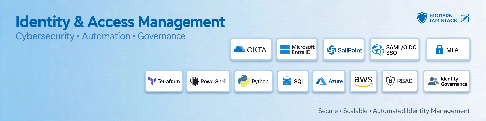
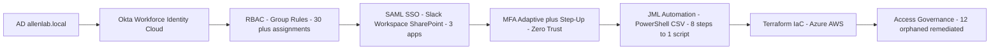

### Sanjeev Shrestha
#### IAM Engineer | Okta Workforce IAM | Microsoft Entra ID | 20 Years IT Experience | Globe Life (2014-2026) | Mid to Senior

🛡 **U.S. Citizen** | 📍 **Allen, TX - DFW** | IAM Engineer roles
🔗 LinkedIn: linkedin.com/in/sanjeev-shrestha-iam | 💻 github.com/sanjeev0276

---

#### Portfolio Note

The projects in this portfolio are intentionally designed to **simulate the real workflows of an Identity & Access Management (IAM) Engineer working in enterprise environments** - built from 12 years at Globe Life with 5 years in IAM production.

Each project focuses on practical enterprise IAM tasks such as **identity lifecycle automation (JML), RBAC design, access governance, privileged access management, Zero Trust, and integration between systems like Active Directory, Okta, and Microsoft Entra ID**.

The goal is to demonstrate **how an IAM Engineer with 20 years of IT experience designs, automates, and manages identity systems at scale**, using scripting (PowerShell, Python), identity platforms, Terraform IaC, and security best practices to enforce consistent access control across hybrid environments.

---
### 🏗️ IAM Architecture - How My Labs Work

**Lab Scale:** 50-user simulation | 30+ RBAC audited | 12 orphaned remediated | 8 manual steps (~2 hrs) → 1 script (~15 mins) | Pattern repeatable for 500+ enterprise

### Identity & Access Management Labs

**🔹 [Okta-IAM-Lab-Series](https://github.com/sanjeev0276/Okta-IAM-Lab-Series) - 6 Labs**
AD allenlab.local → Okta *.okta.com → RBAC → SAML SSO Slack/Workspace/SharePoint → MFA Adaptive Zero Trust → JML Automation PowerShell CSV Batch
`PowerShell | Okta Workforce | SAML 2.0 | MFA | RBAC | JML`

**🔹 [Sanjeev-Okta-Workforce-IAM-Lab](https://github.com/sanjeev0276/Sanjeev-Okta-Workforce-IAM-Lab) - 5 Labs**
SAML SSO, RBAC, MFA, JML Lifecycle, Group Rules and Access Governance
`Okta | SAML/OIDC SSO | RBAC | Lifecycle | Access Governance`

**🔹 [Sanjeev-IAM-HomeLab-Portfolio](https://github.com/sanjeev0276/Sanjeev-IAM-HomeLab-Portfolio)**
Dallas IAM Engineer labs: AD, Entra ID, Okta, SSO, PIM, Zero Trust - Simulating enterprise IAM scenarios across
`Active Directory | Entra ID | Hybrid AD | Conditional Access | PIM | Terraform | PowerShell`

---

**Current Focus:** SailPoint IIQ Training | TechFios IAM Program | Targeting IAM Engineer roles Jan 2027 - DFW / Plano / Frisco / Richardson

**Stack:** Okta | Microsoft Entra ID | SailPoint | SAML/OIDC SSO | MFA | RBAC | JML | Terraform | PowerShell | Python | SQL | Azure | AWS
